 

 

### From problem to production

I lead the digital transformation of an international engineering group — **design the process, model the data, build the solution, put it live**. From the database to the web app, the dashboard and the AI agent. With AI-assisted development I deliver in weeks what used to take months, and I turn manual controls into systems that work on their own, 24/7.

 

### What I build

<table>
<tr>
<td width="50%" valign="top">

**Internal web platforms** 
Next.js / TypeScript / Node.js apps that replace Excel and paper — budgeting and CRM, quality management, HR, attendance, carbon-footprint calculation, document management.

</td>
<td width="50%" valign="top">

**Process automation** 
Continuous controls on ERP + SQL Server, risk traffic-lights and alerts in minutes instead of manual month-end checks.

</td>
</tr>
<tr>
<td width="50%" valign="top">

**Data & decision-making** 
35+ management reports and dashboards — Power BI and real-time web apps: multi-company cash-flow, billing forecast, budget vs. actual.

</td>
<td width="50%" valign="top">

**Infrastructure & security** 
Microsoft 365, Entra ID (hybrid AD), conditional access, passkeys, EDR, Cisco/Meraki networks.

</td>
</tr>
</table>

### Applied AI, wired to real data

Custom **MCP servers** give AI agents controlled access to SQL Server, Microsoft 365 / Graph and Jira — least privilege, restricted writes, confirmation steps and a full audit trail. Humans validate the critical points.

### Stack

Also: T-SQL · SQL Server · SQL Agent · stored procedures · PHC ERP · Power Automate · Power Apps · SharePoint Online · Azure · .NET · ETL · RAG

### How I work

<table>
<tr>
<td align="center" width="25%"><b>End to end</b> I own the whole chain, not just a slice.</td>
<td align="center" width="25%"><b>One source of truth</b> One business rule, one place, no parallel spreadsheets.</td>
<td align="center" width="25%"><b>Human in the right place</b> Automate the repetitive; people validate what is critical.</td>
<td align="center" width="25%"><b>Secure by default</b> Audited writes, least privilege, full traceability.</td>
</tr>
</table>

### Now

- Leading IT, enterprise systems and in-house software development at **M.N. Ramos Ferreira – Engenharia**
- Building **[BuildFlow](https://buildflow.pt)** — SaaS for the construction sector
- Exploring agentic workflows and MCP integrations between AI and business systems

<b>Background</b>

 

Postgraduate degree in Business Process Engineering and Management and MSc in Electrical and Computer Engineering, both at FEUP (University of Porto), with an Erasmus period at Poznań University of Technology.
Languages: Portuguese (native) · English (fluent) · French (basic).

 

Most of my work lives in private repositories — what you see here is a small public slice.

